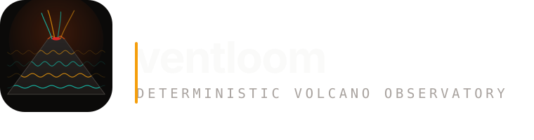

# ventloom

> **vx** deterministic volcano observatory. Weave volcanic signals into an eruption forecast.

<p align="center">
  
</p>

<p align="center">
  
  
  
  
  
  
</p>

## What this is

ventloom is a volcano observatory that runs entirely in your browser. No API keys,
no network, no session. It deterministically synthesises a full volcanic
monitoring network from a single 32-bit seed (7331) and lets you invert the
resulting deformation field for the buried source beneath.

It is a **simulation**, and it says so everywhere the numbers appear. The Earth is
not on a schedule, and an imaginary volcano is the only kind that can be made
reproducible.

## Capability matrix

| Surface | What it delivers |
| ------- | ---------------- |
| **Geodesy** | Mogi source inversion (Levenberg–Marquardt, analytic Jacobian, covariance) with the depth/volume trade-off honestly reported |
| **Seismic** | Radix-2 Cooley-Tukey FFT spectrogram, RSAM, crest factor, spectral flatness, tremor band ratios |
| **Tephra** | Aitchison distance on the compositional simplex, single-linkage clustering, four end-member volcanic types |
| **Forecast** | Ten-rule, ordered, family-corroborated alert engine (NORMAL/ADVISORY/WATCH/WARNING) with a situation report |
| **Replay** | Scrub 0 → 365 days and watch the whole observatory move with the epoch |
| **Volcanoes** | 12 systems, 84 stations, 5 instrument families |
| **Cross-language oracle** | Rust re-implementation of the Mogi solver, checked against TypeScript at 1e-6 relative |
| **Bulletin service** | Python (FastAPI) renderer that emits the same ten-rule verdict and Aitchison distance |
| **Relay daemon** | Go (stdlib-only) bounded-memory telemetry polled every minute, with honest poll ages |
| **Social card** | Per-volcano, per-epoch PNG cards rendered with `ImageResponse` |

## Architecture at a glance

```mermaid
graph LR
    classDef seed fill:#14532d,stroke:#22c55e,color:#ecfdf5
    classDef core fill:#1e3a5f,stroke:#38bdf8,color:#f0f9ff
    classDef surface fill:#3b2f0b,stroke:#f59e0b,color:#fffbeb
    SEED[WORLD_SEED = 7331]:::seed --> RNG[mulberry32]
    RNG --> CORE[@repo/core]:::core
    CORE --> NU[Next.js app]:::surface
    CORE --> SDK[@repo/sdk]
    CORE --> RUST[crates/engine]:::surface
    CORE --> PY[agents service]:::surface
    NU --> BROWSER[Browser]
    classDef app fill:#3b2f0b,stroke:#f59e0b,color:#fffbeb
    class BROWSER app
```

Sixteen diagrams live in [`docs/diagrams/`](docs/diagrams/README.md). The full
system picture is [`docs/diagrams/system-architecture.md`](docs/diagrams/system-architecture.md).

## Getting started

```bash
git clone https://github.com/aniruddhaadak80/ventloom.git
cd ventloom
bun install
bun run dev
```

Then open `http://localhost:3000`. Full details in [`docs/guides/quickstart.md`](docs/guides/quickstart.md).

## The epoch is the state

Every URL carries `?epoch=seconds&volcano=id`, and that is the **entire** state.
There is no session, no cache and no "latest". Two people opening the same
URL see the same numbers, today and next year. See
[`docs/adr/0002-epoch-is-the-whole-state.md`](docs/adr/0002-epoch-is-the-whole-state.md).

## Code layout

| Path | What | Toolchain |
| ---- | ---- | --------- |
| `apps/web` | Next.js 15 app, 27 routes, the observatory itself | Bun |
| `packages/core` | The deterministic engine: Mogi, FFT, tremor, tephra, forecast | TypeScript |
| `packages/seed` | Catalogue, station network, tephra layers, generator | TypeScript |
| `packages/ui` | Primitives (Panel, Meter, Waveform, Spectrogram) + CSS tokens | TypeScript |
| `packages/sdk` | Typed `ObservatoryClient` + `invertLocally` | TypeScript |
| `crates/engine` | Rust reference oracle (Mogi, FFT, dense solve) | Cargo |
| `services/agents` | FastAPI bulletin renderer + Aitchison distance | Python 3.12 |
| `services/relay` | Stdlib-only telemetry daemon + ring buffer | Go 1.24 |
| `scripts/gen-assets.mjs` | Deterministic SVG identity generator | Node (Bun) |

## Running the tests

```bash
bun run typecheck          # tsc --noEmit on every package
bun run lint               # biome check .
bun run test:unit          # vitest, 134 tests
bun run build              # next build, 24 static pages
bun run test:e2e           # playwright, 18 assertions
cd crates/engine && cargo test
cd services/relay && go test -race ./...
cd services/agents && pytest
```

`bun run check` runs the first four in a row.

## Contributing

Read [`CONTRIBUTING.md`](CONTRIBUTING.md) first. The short version: one logical
change per commit, run the gates locally, and any formula change in one language
owes a parity assertion in the others.

## Security

See [`SECURITY.md`](SECURITY.md). ventloom is read-only, stateless and holds no
secrets. Still, please report through the security advisory flow rather than a
public issue.

## Documentation map

| I want to… | Go to |
| ---------- | ----- |
| Run it locally | [`docs/guides/quickstart.md`](docs/guides/quickstart.md) |
| Understand a subsystem | [`docs/diagrams/`](docs/diagrams/README.md) |
| Read why something was decided | [`docs/adr/`](docs/adr/0001-record-architecture-decisions.md) |
| Find the alert rules | [`docs/diagrams/alert-engine.md`](docs/diagrams/alert-engine.md) |
| See the deploy options | [`docker-compose.yml`](docker-compose.yml), [`fly.toml`](fly.toml), [`render.yaml`](render.yaml), [`railway.json`](railway.json) |

## Deploying

### Vercel (the live instance)

```bash
vercel deploy --prod
```

The build command, output directory and routes are in [`vercel.json`](vercel.json).

### Docker

```bash
docker build -t ventloom .
docker run -p 3000:3000 ventloom
```

### Fly / Render / Railway

Each has a config file at the root. They all use the same `Dockerfile`. The Go
relay and the Python agents ship their own Dockerfiles under `services/`.

See [`docs/guides/deploy.md`](docs/guides/deploy.md) (if you add one; quickstart
covers the canonical Vercel path).

## License

[MIT](LICENSE) — © 2026 Aniruddha Adak.

## The seed

7331. Everywhere. `WORLD_SEED`, the build ID (`ventloom-7331`), the RNG
initial state, the `seed` field on `/api/network` and the social card. Searching
the repo for `7331` and finding exactly the places you expect is itself a check
that nothing has gone off.

---

*Aniruddha Adak · [DEV](https://dev.to/aniruddhaadak) ·
[x](https://x.com/aniruddhaadak) ·
[GitHub](https://github.com/aniruddhaadak80)*
