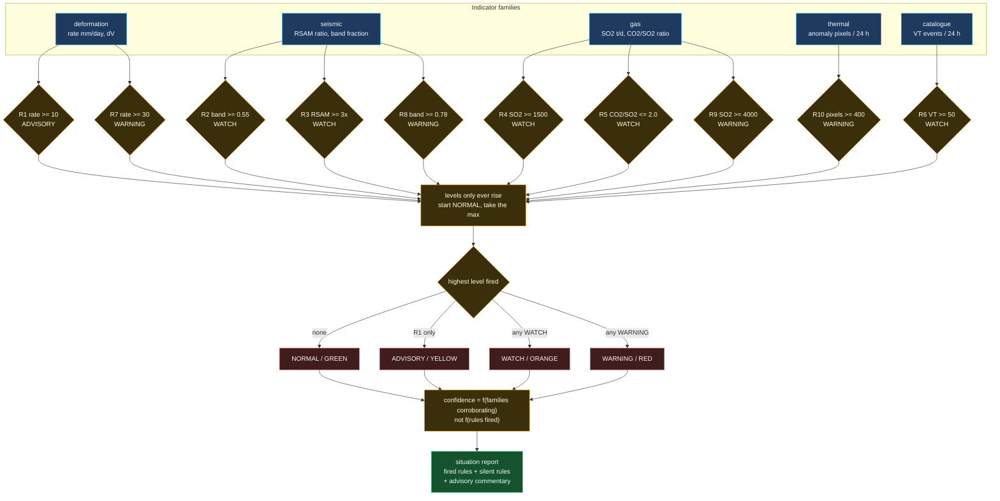

# Alert engine

The ordered rule table that turns frozen indicators into a level a person is
expected to act on. Implemented twice, in TypeScript and Python, and pinned
between them by tests.

## Why confidence counts families, not rules

It is tempting to score confidence as "how many rules fired". Ten rules firing
would then read as near-certainty, and that is a dangerous reading: all ten
could be driven by a single malfunctioning GNSS bench whose monument has
started to tilt. Ten alarms from one instrument are still one instrument.

So confidence is driven by how many *independent families* corroborate. A
deformation signal plus a seismic signal plus a gas signal is three lines of
evidence from three physically separate measurement chains, and that is what
earns a high score. This is also why the verdict reports the silent rules
alongside the fired ones: a bulletin that lists only its evidence is not
auditable, because the reader cannot see what was checked and passed.

## Why the levels only ever rise

The table is evaluated in order and each firing can only *raise* the level.
Two reasons. Operationally, an observatory that oscillates between WATCH and
ADVISORY as a single indicator wanders across a threshold generates alarm
fatigue, which is how people stop reading bulletins. Formally, the thresholds
are not a partition of indicator space - R1 and R7 both test the deformation
rate, at different levels - so the natural reading of "the last rule that
fired" would give a *lower* answer for a more severe signal.

## The CO2/SO2 rule fires downward

Every other threshold is `>=`. R5 is `<=`, because a *falling* CO2/SO2 ratio is
the signal: CO2 exsolves at depth and SO2 higher up, so a ratio dropping toward
2.0 means magma has arrived in the shallow conduit where it can actually
erupt. A reader scanning the table for `>=` will misread it, which is why the
rule's statement text says so in words.
