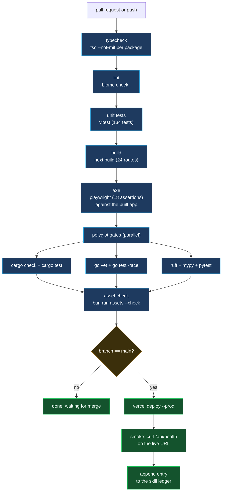

# CI pipeline

Four gates and a deploy, in order, none of which depend on anything that has
not already passed.

## What each gate actually checks

| Gate | What would pass silently if it did not run | What a failure looks like |
| ---- | ----------------------------------------- | ------------------------- |
| `tsc --noEmit` | A renamed field in `@repo/core` breaking the SDK | red squiggles in CI logs |
| `biome check .` | An unused import, a `any`, an unhandled promise | a diff of the offending lines |
| `vitest` | The Mogi Jacobian off by a factor, silently | a specific assertion + the tolerance |
| `next build` | A missing `generateStaticParams`, a broken import | a stack trace in the build phase |
| `playwright` | A regression in the rendered page | screenshots + trace in artifacts |
| `cargo check` / `test` | A drift between Rust and TypeScript solvers | a named assertion + diff |
| `go vet` / `test -race` | A data race in the ring buffer | a stack trace + goroutine dump |
| `ruff` + `mypy` + `pytest` | A typo in the rule table, a broken bullet | FastAPI's validation errors |
| `assets --check` | A hand-edited SVG drifting from the generator | the list of mismatched files |

## Why `verify-before-completion` is a gate and not a suggestion

The habit this repo is built to enforce: evidence before assertions. Every "done" claim in the skill entries comes with the command that produced the green output, not with a reader's impression that it probably works. The workflow file makes running the gates cheaper than not running them, so that the default path is the correct one.
