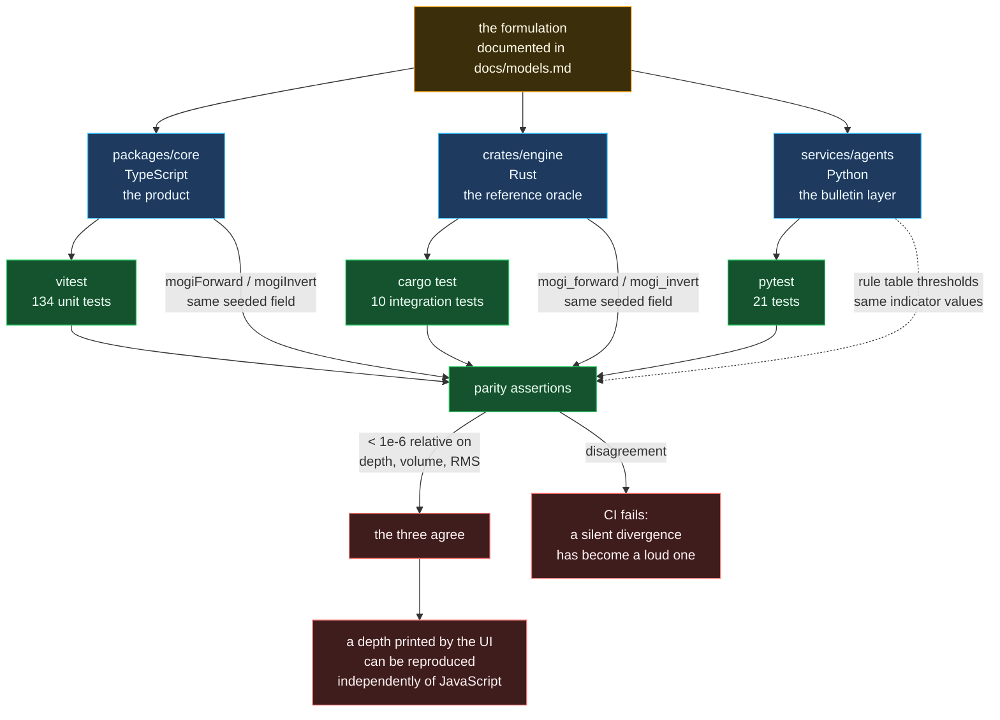

# Cross-language parity

Three implementations of the same maths, and the tests that keep them honest.

## Why write it three times

An inversion that only exists in one language is an inversion that cannot be
cross-checked. If `mogi.ts` has an algebra slip in its Jacobian, every test in
the repo passes - the tests assert against the same formulas, so a consistent
error is invisible. Reimplementing the same closed forms in Rust from the
documentation, without looking at the TypeScript, produces a second opinion
that disagrees whenever the first is wrong.

This is not hypothetical. Writing the Rust version surfaced a genuine
precedence bug in the degrees-of-freedom expression: `n * 3 - 4` written as
`n * (3 - 4)` compiles, passes a smoke test, and silently inflates every χ² in
the output. It was found by a parity assertion, not by reading the code.

## What is NOT cross-checked

The FFT is verified in Rust against known analytic properties - a pure tone
recovered to sub-bin accuracy, unit amplitude preserved through the window
correction, an exact bin-centred tone showing no leakage - rather than against
the TypeScript output. That is a weaker guarantee, and it is deliberate: the
two implementations agree on bin ordering, normalisation and windowing, so a
numeric diff would be dominated by round-off ordering rather than by
meaningful disagreement. The analytic tests are the sharper instrument here.

## What each language is actually for

| Language | Role | Why it exists |
| -------- | ---- | ------------- |
| TypeScript | The product | Runs in the browser and in Next.js; it is what a reader sees |
| Rust | The check | No React, no HTTP, no seed catalogue: numbers in, numbers out |
| Python | The bulletin | Text rendering and compositional statistics, in the language that does both well |
| Go | The relay | A long-running daemon with bounded memory and no dependency graph |
