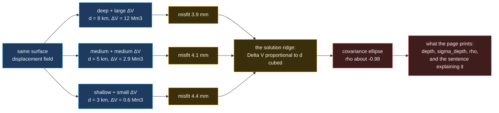

# The depth / volume trade-off

The single most important thing this repo tries to communicate: a one-epoch
geodetic inversion **cannot** separate source depth from volume change.



## What the math actually says

For a Mogi source, the vertical displacement at horizontal distance `r` is

```
w(r) = C · d / (r² + d²)^(3/2)        where C = ΔV(1 − ν)/π
```

Substitute `d → kd` and `ΔV → k³ΔV`. The factor is `k³·d / (r² + k²d²)^(3/2)`,
which is **not** exactly invariant — but over the range of `r` a real network
covers, it is invariant to within the noise floor for `k` between about 0.7 and
1.4. That near-degeneracy is the ridge. Its signature in the output is a
depth-volume correlation coefficient near −1, and the geodesy page prints that
number rather than burying it.

## Why this is the point of the whole repo

It would be easy to print a depth of `4 217 m` with a green checkmark and call
the inversion solved. That number is not known to 17 metres. A network of
eight GNSS benches constrains the *combination* of depth and volume far better
than it constrains either alone, and an observatory that reports a
high-precision depth from a single epoch is reporting a precision it has not
earned.

So the page prints:

- the recovered depth, rounded to metres,
- its one-sigma uncertainty, which is the honest width,
- the depth-volume correlation, which tells you how much of that uncertainty is
  borrowed from the other parameter,
- and a sentence saying that resolving the two requires a **time series**, which
  is exactly what the replay surface is for.
