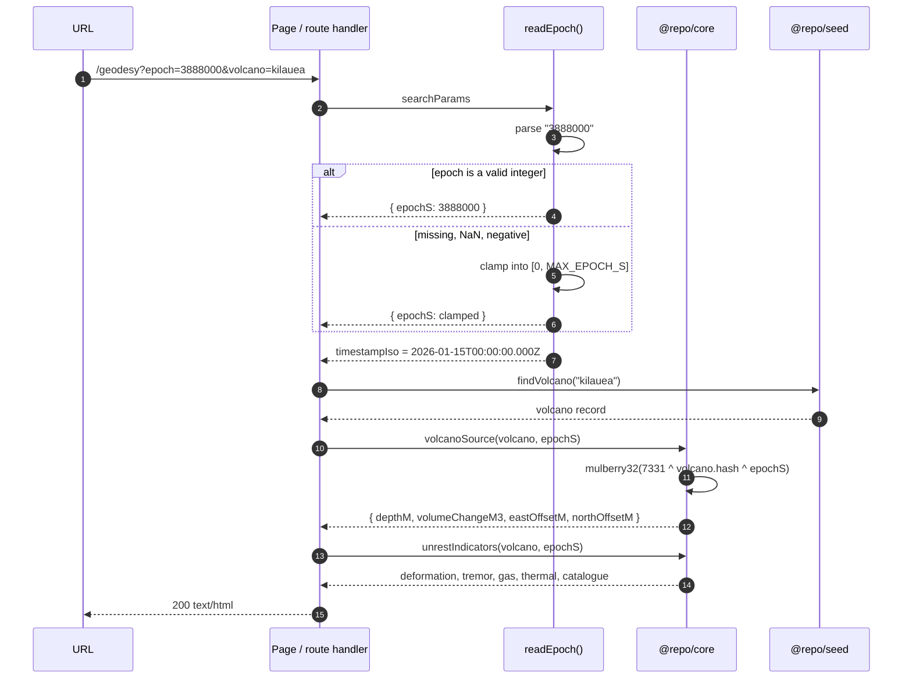

# Epoch resolution

An epoch is an integer number of seconds from the start of the seeded world.
There is no wall clock anywhere in ventloom, which is why the same URL always
renders the same page.

## The bounds

| Constant | Value | Meaning |
| -------- | ----- | ------- |
| `DEFAULT_EPOCH_S` | 3 888 000 | 45 days: far enough in to show unrest developing |
| `MAX_EPOCH_S` | 31 536 000 | 365 days: one seeded year, then the world stops |
| `SECONDS_PER_DAY` | 86 400 | used only for rate display |

## Why clamp rather than reject

A URL is not an API call. Someone will paste `?epoch=-5` or `?epoch=abc` into a
browser, and the two defensible responses are a 400 with an explanation or a
clamped value with the resolved epoch shown in the header. A 400 makes the
observatory look broken to a curious visitor; a silent default makes it look
broken to a returning analyst. Clamping, and printing the epoch that was
actually used in the page header, gets both: the page always renders, and it
always says what it rendered.

## Why epoch is in every URL

Because it makes the whole observatory shareable and bookmarkable. Sending a
colleague `?epoch=2592000&volcano=merapi` sends them the exact state you are
looking at, including every number on the page. That is only possible because
the epoch is the *entire* state; there is no session, no cache and no
"latest" to drift.
