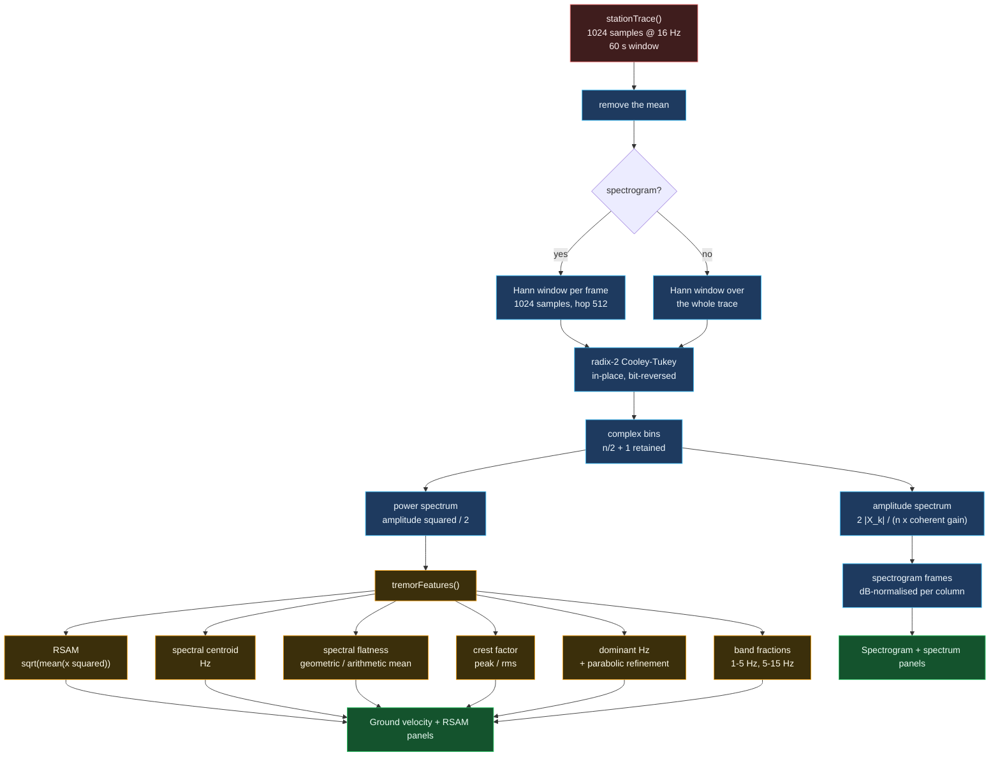

# FFT and spectrogram pipeline

From a 60-second ground-motion trace to the two plots on `/seismic`.

## Why a power-of-two length is mandatory

The radix-2 butterfly decomposition needs `n = 2^k`. Rather than zero-pad
silently — which would lengthen the window, smear a transient and change the
frequency resolution the reader is looking at — `fft.ts` **throws**. A caller
who passes 1000 samples has made a modelling decision, not a typo, and the
right response is to make them state it.

## Why the Hann window, and why the correction factor

A rectangular window convolves every tone with a sinc, whose sidelobes decay
only as 1/f. A 1.5 Hz tremor tone would then leak energy into every bin out to
Nyquist, and the 1-5 Hz band ratio — the number the alert engine actually
consumes — would be contaminated by energy that is not there.

Hann's sidelobes decay as 1/f³, at the cost of a wider main lobe and a coherent
gain of exactly 0.5. That 0.5 is why the amplitude formula divides by the
window's mean: without it, a unit sinusoid reports an amplitude of 0.5, and
every absolute level in the observatory would be 6 dB wrong.
`fft.test.ts` asserts a unit tone recovers to within 2 %, which is the test
that would catch a missing correction.

## Why parabolic interpolation on the peak

Bin spacing at 16 Hz over 1024 samples is 0.056 Hz, so an unrefined peak is
quantised to ±0.028 Hz. That is small, but the tremor band boundary is at 5 Hz
and a harmonic sitting near it can be pushed across by quantisation alone. Fitting
a parabola through the peak bin and its two neighbours recovers the true
frequency to a small fraction of a bin, using three numbers and no extra FFT.
