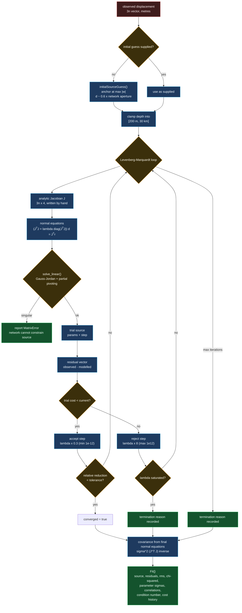

# Mogi source inversion loop

Levenberg-Marquardt on four parameters `(e, f, d, ΔV)`, with the analytic
Jacobian. This is the signature surface of the repo.

## Why a hand-written Jacobian

A centred finite difference has a truncation error of O(h²) and a round-off
error of O(ε/h). With a 4 mm measurement noise floor and ε ≈ 2.2e-16, the
optimal step is around 1e-5 m and the best achievable derivative accuracy is
roughly 1e-6 m/m. That sounds fine until you notice the solver would then be
spending its iterations chasing *differencing* error rather than misfit. Writing
the four partial derivatives out closes that off entirely, and
`mogi.test.ts` checks them against a finite difference at a tolerance of 1e-5,
so the algebra is verified rather than trusted.

## Why the damping is against the diagonal

Levenberg's `(JᵀJ + λ·diag(JᵀJ))` form scales each parameter's damping by its
own curvature. Marquardt's original `(JᵀJ + λI)` does not, which means a
parameter measured in cubic metres and one measured in metres get the same
additive damping even though their normal-equation diagonals differ by twelve
orders of magnitude. In geodetic inversions that mismatch is the difference
between a solver that converges and one that stalls on its first step.

## Why depth is bounded

The Mogi model has a genuine degeneracy: as `d → ∞` with `ΔV ∝ d³`, the surface
field is unchanged. An unbounded solver will happily walk toward infinity along
that ridge and report a deep, enormous source with an excellent misfit. The
bounds do not hide that degeneracy — the correlation matrix reports it — they
just stop the optimiser from leaving the region where the point-source
approximation means anything.
