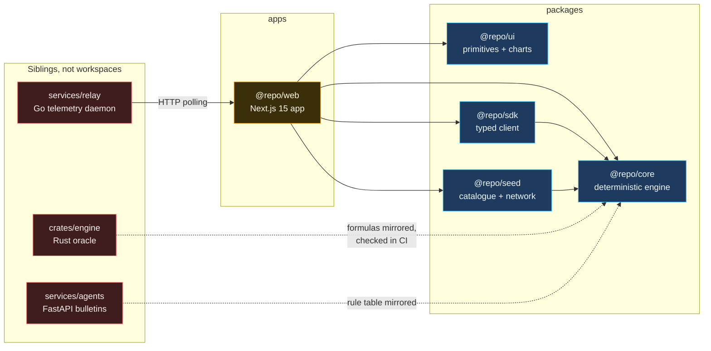

# Monorepo package dependency graph

## Why the polyglot services are siblings and not workspaces

`crates/`, `services/` and `packages/` look similar on disk and are not. The
Bun workspace globs are `apps/*` and `packages/*` only, so Cargo, pip and the
Go toolchain each manage their own dependency graph entirely independently.

That boundary is deliberate. A `cargo build` must not be able to break
`bun run typecheck`, and a Python transitive dependency bump must not appear
in `bun.lock`. Each toolchain owns its own lockfile, its own CI job and its own
failure mode. The only coupling between them is the *agreement* enforced by
tests: the Rust solver against the TypeScript one, and the Python rule table
against the TypeScript one.

## Acyclicity

The directed graph is acyclic and `@repo/core` is a leaf that nothing in
`packages/` depends on upward. `@repo/ui` imports nothing from this repo at
all, which is why it can be extracted into a standalone component library by
copying one directory.
