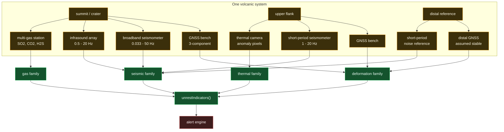

# Station and instrument network

The 84 instruments across 12 volcanic systems, and what each one is for.

## The composition, by instrument

| Instrument | Count | What it constrains |
| ---------- | ----- | ------------------ |
| GNSS | 25 | Three-component displacement; the deformation family |
| Broadband seismic | 24 | Low-frequency tremor, VT locations, the noise floor |
| Short-period seismic | 15 | Higher-frequency content, and the distal noise reference |
| Infrasound | 16 | Explosive activity; acoustic energy that seismic alone cannot separate |
| Multi-gas | 4 | SO2 and CO2 flux; the gas family |

## Why a distal reference station matters

Every measurement needs something to be measured *against*, and the distal
station is that: sited on bedrock far enough away that volcanic deformation
falls below the noise, it gives the network a stable frame. Without it, a slow
regional tilt would be indistinguishable from inflation of the edifice, because
there would be nothing on the map that was known not to be moving.

It also serves a second purpose that is easy to overlook: the distal
short-period station is the **noise reference**. Background seismic noise is
not a constant - it is 1/f² below roughly 1.5 Hz and flat above, and it varies
by site. Measuring the RSAM ratio against a 30-day background *at the same
station* is what makes "3x background" mean something. Comparing a flank
station's raw amplitude against a different station's background would report
site effects as unrest.

## Why only 4 gas stations

Gas flux is the measurement that scales worst. SO2 needs either COSPEC, which
is being retired almost everywhere, or DOAS traverse work, which needs a person
in the field on the right wind. A realistic network has far fewer gas
instruments than seismometers, and the alert engine is built so that the gas
family is *corroborating* rather than required. A WATCH level that fired on
seismic and deformation alone is still a WATCH level.
