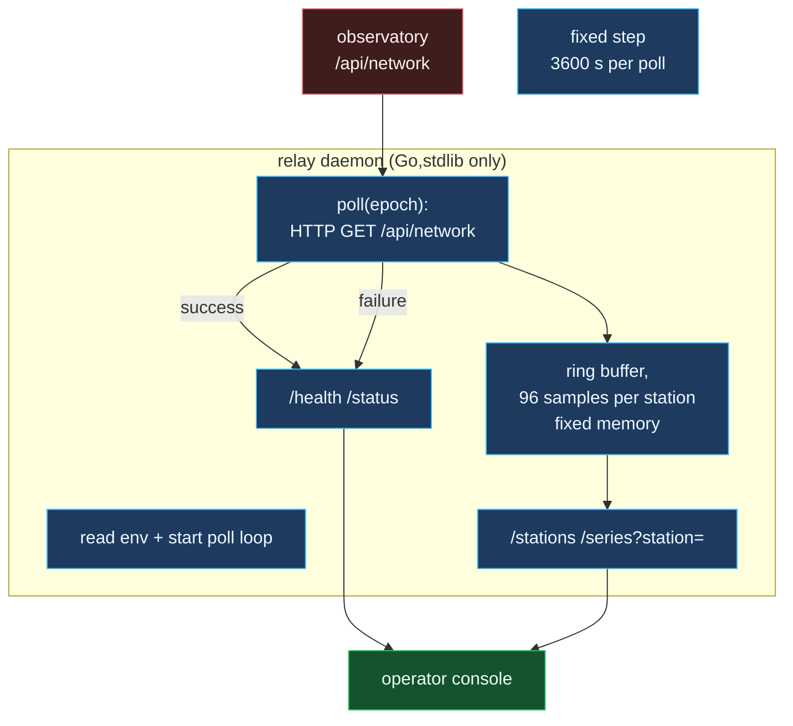
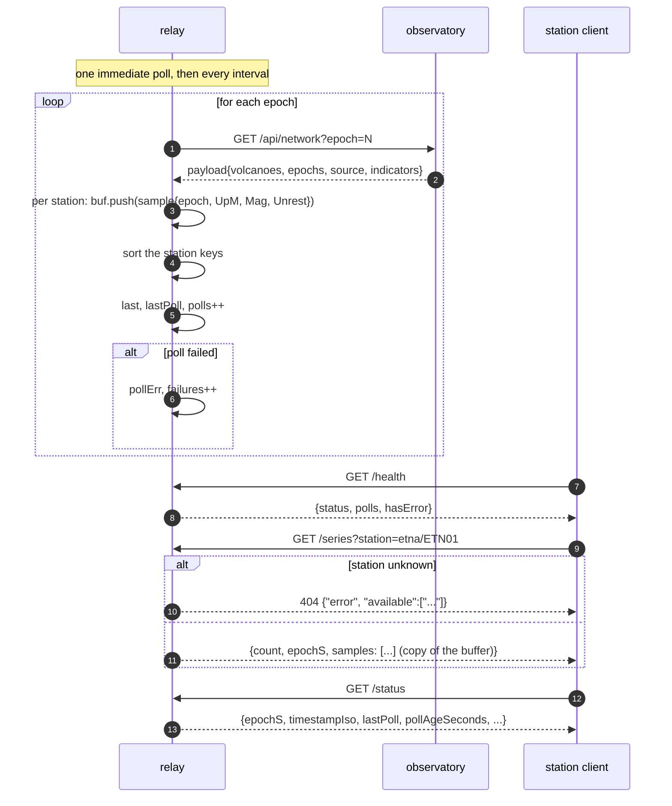

# Relay daemon

The Go service that sits between the observatory and anything that wants to
watch it.

## Why a daemon rather than on-demand

A real observatory console needs a *current* value at a glance: a person
arriving at a shift handover does not want to trigger a recompute of the world
by clicking a button, and they especially do not want the answer to be "the
world, as of whatever epoch the URL happened to carry". The relay polls at a
fixed cadence, walks the seeded year one hour per request, and keeps a bounded
ring so the console can draw the last three hours of each station as a sparkline
without a round trip to the core.

## Why bounded memory

The ring is 96 samples deep, which at one sample per hour per station is
four days of history. A daemon that grows with uptime is a daemon that dies at
2 a.m. in a way that shows up only as a missing morning shift, and the
observatory's job is to be least fragile exactly when nothing interesting
has happened in months.

## Why no cache between the browser and the upstream

The relay's `/status` reports how old its reading is. A cache in front of the
observatory that silently substituted a 30-minute-old body for the fresh one
would make that number a lie, and a lie about currency is the one failure
mode that cannot be seen in the data. The observatory itself is safe to
cache — it is a pure function — but the thing that *reads* it for duty staff
is not, because a stale reading presented as current is the exact failure
that alert systems exist to prevent.

## Why stdlib only

Go's standard library covers HTTP servers, JSON encoding, signal handling and
concurrency well enough for a read-only daemon that makes one upstream request
per minute. A relay that needs a dependency graph to watch eleven HTTP
endpoints is a relay that will eventually refuse to build on a machine that
does not have exactly the right go.sum, which is a polite way of saying it
will be deleted by the first tired person who needs to restart prod.
