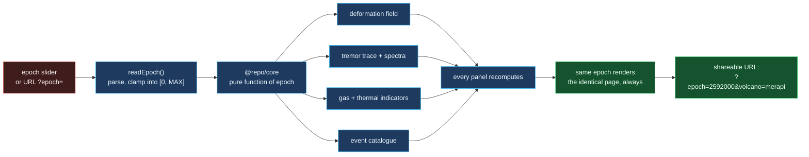

# Replay timeline

The deterministic time machine: scrubbing an epoch and watching the whole
observatory move with it.

```mermaid
gantt
    title The seeded year, 0 to 31,536,000 seconds
    dateFormat X
    axisFormat %s

    section Epochs
    day 0    (background)      :done,    0,     3888000
    day 45   (default)         :active,  3888000, 7776000
    day 90                     :crit,    7776000, 15552000
    day 180                    :crit,    15552000, 23328000
    day 365 (world ends)       :done,    23328000, 31536000
```

## What "deterministic" buys you here

Three properties that are usually impossible to have at once:

1. **Reproducibility.** Two people opening the same URL see the same numbers,
   on different machines, months apart.
2. **No state.** There is no session, no database and no "latest". The server
   can be restarted mid-scrub and the next request is identical.
3. **Bookmarks.** The entire observatory state fits in a query string.

These hold because nothing in the compute path reads a clock. The one place
time appears is `readEpoch`, which converts a URL parameter into a world
timestamp, and it is a pure conversion.

## Why the slider is not a form submission

Scrubbing an epoch is a continuous gesture, and a full page navigation per
position would make the control unusable. The replay surface updates the query
string with `history.replaceState` as you drag, so the URL always reflects what
is on screen and the back button still works — while every panel recomputes from
the same pure functions the server rendered.

## The honest limitation

Determinism is a property of *this* repo, not of volcanology. A real
observatory ingests data that arrives late, gets revised and is occasionally
wrong. ventloom sidesteps that entirely by generating its world from a seed,
which buys perfect reproducibility at the cost of being a simulation. The
README says so rather than implying the numbers describe real unrest at
Kilauea, and every volcano page labels its indicators as synthetic.
