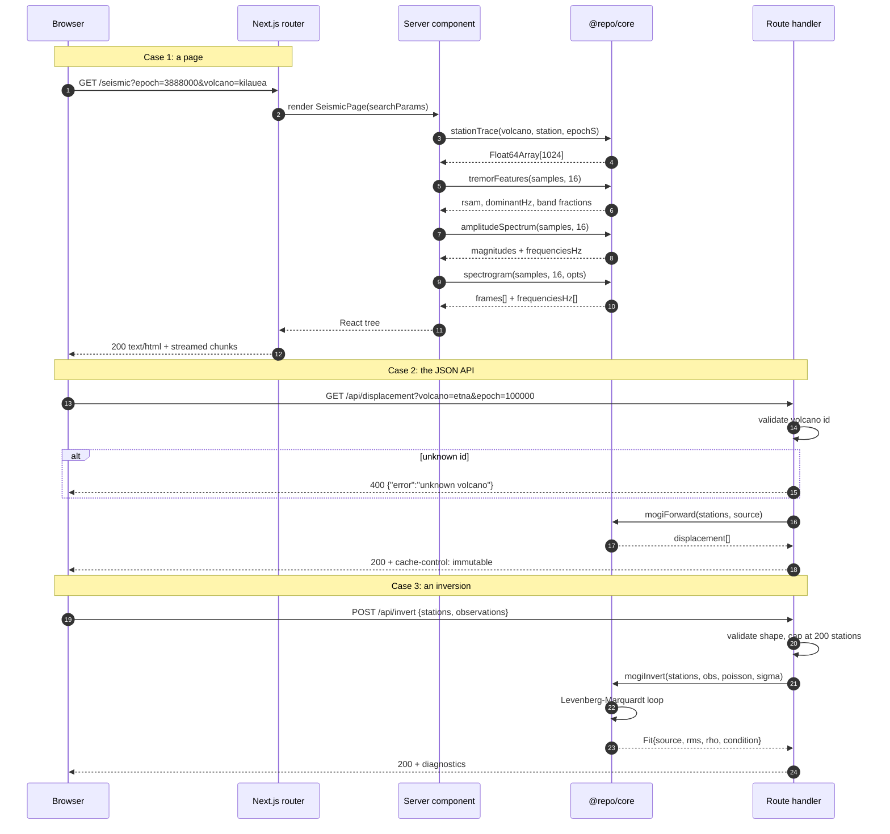

# Request lifecycle

What happens between a click and a rendered panel, for both the static pages
and the JSON endpoints.

## Why the pages compute on the server

Every panel on `/seismic` is derived from a 1024-sample trace and an FFT with
an O(n log n) cost, and the spectrogram is a 2-D array of frame energies. Doing
that in the browser would work, and would also mean the first paint depends on
a JavaScript download and parse. Rendering it on the server means the numbers
are in the HTML: the page is readable, linkable and screen-reader-accessible
before any script runs, and it degrades to text if the client bundle never
arrives.

## Why `cache-control: immutable`

The displacement and network responses are a pure function of the query string.
Two requests with the same `volcano` and `epoch` produce byte-identical bodies,
forever, so any cache that keys on the full URL can hold the answer
indefinitely without ever serving something wrong. That is a stronger guarantee
than most APIs can honestly make, and it is worth stating explicitly rather
than leaving a client to guess at a `max-age`.

Note the trap this avoids: these handlers are `force-dynamic`, not
`force-static`. A parameterised route marked `force-static` is evaluated once
at build time with an empty query string and its response — often a 400 — is
baked into the build output.
