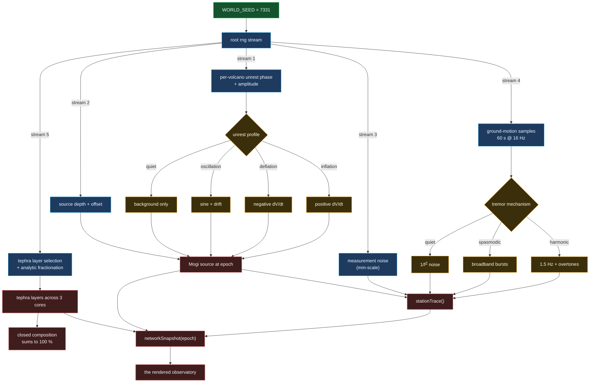

# Seed 7331 to a full world

Every random number in ventloom descends from one 32-bit integer. Nothing calls
`Math.random`, so the world is reproducible across machines, runs and
languages.

## Why independent streams rather than one shared generator

A single stream means that adding one random number early in the pipeline
shifts **every** number after it, so a one-line change to the plume width would
silently alter the recovered source depth on every volcano. Deriving named
sub-streams from the root seed isolates them: the deformation stream can change
without touching the geochemistry stream, and both stay reproducible.

## Why `mulberry32`

It is four lines, has a 232-1 period, and — the property that
matters here — is trivially reimplementable in Rust and Python. A cross-language
parity test is only meaningful if all three implementations can be *provably*
drawing from the same sequence, and a well-specified 32-bit integer hash is the
only kind of generator for which that is true. A PCG or xoshiro would also
work; a Mersenne Twister would not, because its state is 2.5 kB and its
reimplementation is easy to get subtly wrong.
