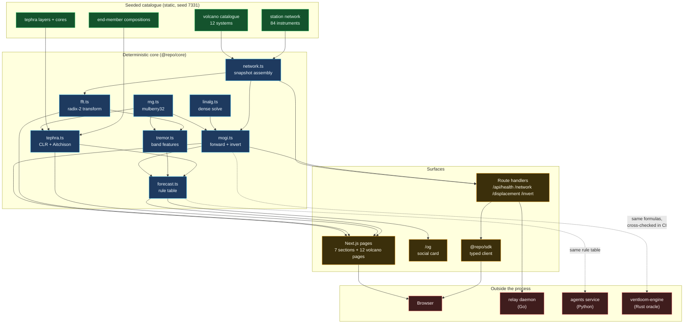

# System architecture

## The one rule this shape encodes

Arrows never point **into** the core from a surface. `@repo/core` imports
nothing from `@repo/ui`, `@repo/sdk` or `apps/web`, and it reads no clock, no
environment variable and no network. That is what makes "the same epoch renders
the same observatory" a testable claim rather than a hope: the entire world is
a pure function of `(catalogue, seed, epoch)`.

The dashed arrows are the ones worth arguing about. They cross a language
boundary on purpose, so that a bug in the TypeScript Mogi solver shows up as a
disagreement with the Rust implementation rather than as a subtly wrong depth
on a dashboard.
