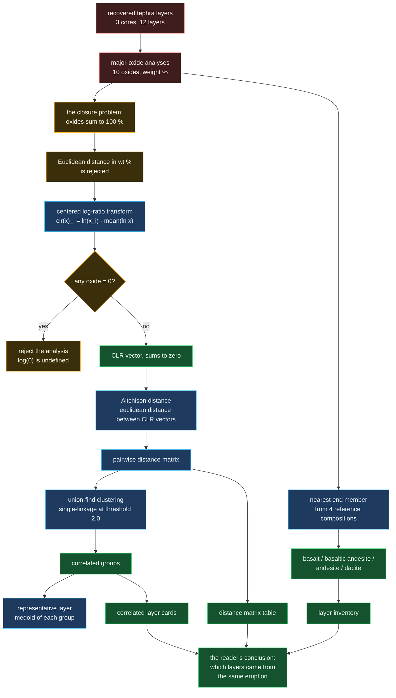

# Tephra correlation

Matching tephra layers between cores by chemistry rather than by depth, using
the metric that compositional data actually requires.

## Why Euclidean distance is wrong here

A major-oxide analysis is a **composition**: the ten oxides are not independent
measurements, they are parts of a whole that sums to 100 %. That closure makes
Euclidean distance meaningless, in a specific and provable way.

Take a basalt measured as 50 % SiO₂ with everything else fixed. Now imagine
the lab reports it after a unit change that doubles every value and renormalises
- the same rock. Euclidean distance between the two reports is large, and the
rock is identical. Any metric that can be moved by renormalising the same
sample is not measuring the sample.

The centered log-ratio transform removes this. Taking logs turns multiplicative
closure into additive closure, and subtracting the mean log makes the result
independent of the total. `clr(x)` always sums to zero, which is asserted in
`tephra.test.ts` and in the Python service's test suite - the two implementations
agree on the transform and on the resulting distances.

## Why single-linkage union-find

Correlation of tephra layers is genuinely transitive in the way single-linkage
captures: layer A may differ from layer B by analytical scatter and B from C
similarly, while A and C sit at opposite ends of the tolerance. Complete linkage
would split that chain into two units and assert an eruption happened twice.
Single linkage says what a field geologist says - these are the same unit,
contaminated differently - and it needs only the distance matrix that has
already been computed.

The threshold of 2.0 is reported alongside every decision rather than held as a
magic constant, in both the UI and the Python service's `/correlate` response,
so a caller never has to go looking for it.
