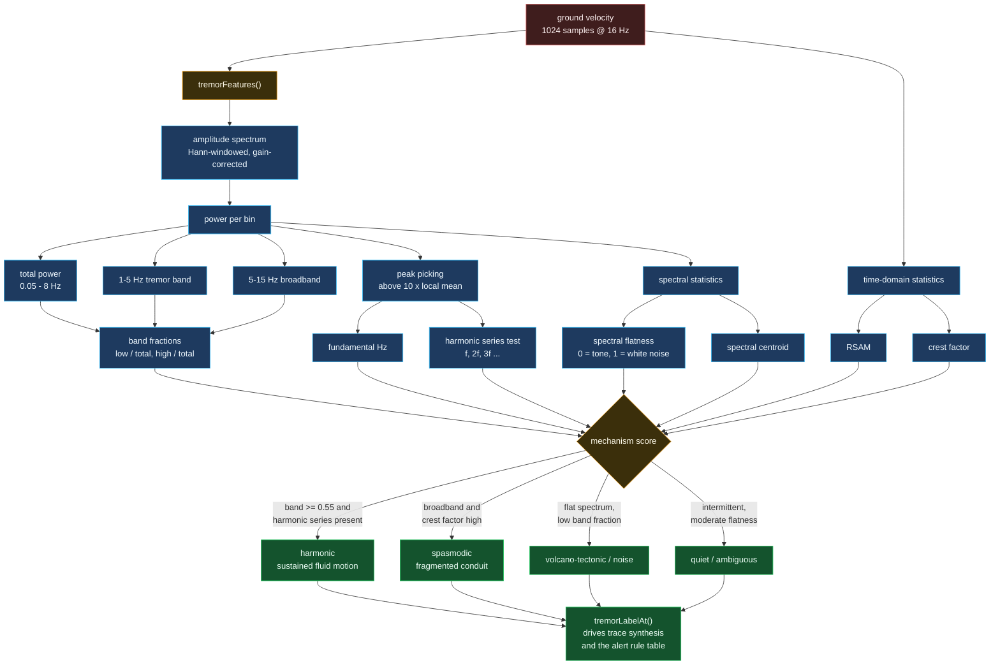

# Tremor classification

How a raw waveform becomes a mechanism label, and why the *band ratios* do the
work rather than the amplitude.

## Why crest factor alone cannot classify tremor

The intuitive read is: tremor is a smooth oscillation, so its crest factor
should be near 1.4, and noise is spiky, so it should be high. That is true of
*white* noise, and completely false of the noise a real short-period station
records. Background seismic noise is roughly 1/f² below about a 1.5 Hz corner
and flat above it, and filtering a signal that way raises its crest factor to
around 9 without making it impulsive at all.

So a crest factor of 9 does not mean "earthquake". The observatory says so
explicitly on the seismic page rather than letting a reader infer the naive
reading, and the classifier leans on the band ratios instead, which separate
these cases cleanly: harmonic tremor puts 70 %+ of its power in 1-5 Hz, and
background noise puts almost none there.

## Why the fundamental is only sometimes detectable

A harmonic tremor's fundamental sits near 1.5 Hz. At 16 Hz sampling over 60
seconds, bin spacing is 0.056 Hz, which resolves 1.5 Hz comfortably in
principle. In practice the fundamental is the *weakest* member of the series
— conduit resonance radiates more efficiently at its overtones — so it often
sits within a few dB of the noise floor while the 3 Hz and 4.5 Hz harmonics
are unmistakable. The classifier therefore treats a missing fundamental as
weak evidence rather than as disproof, which is why the harmonic series test
is a separate input to the score rather than a gate.
